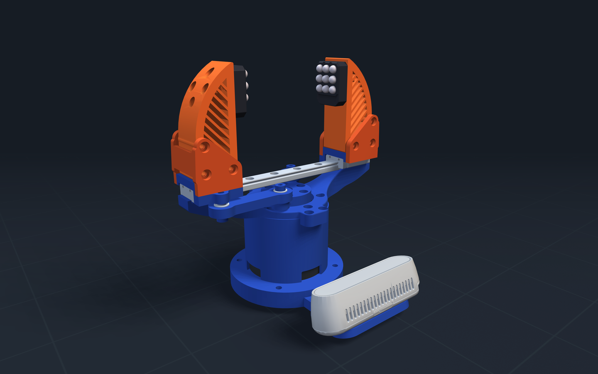
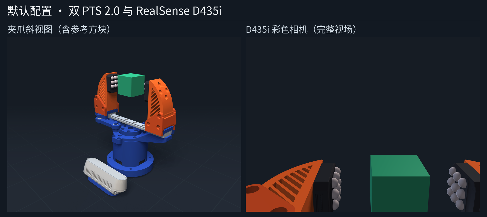
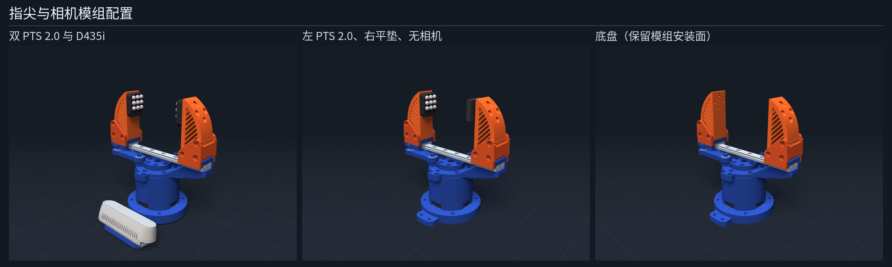
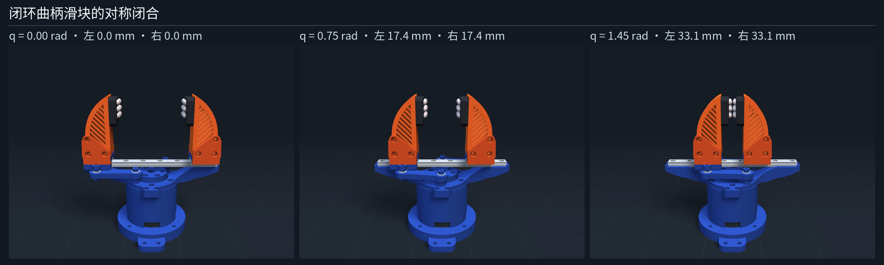
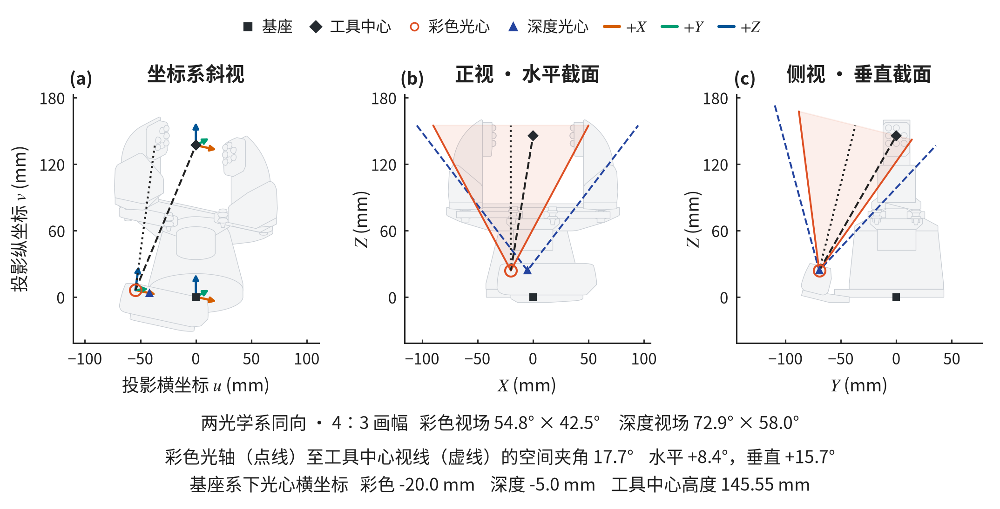
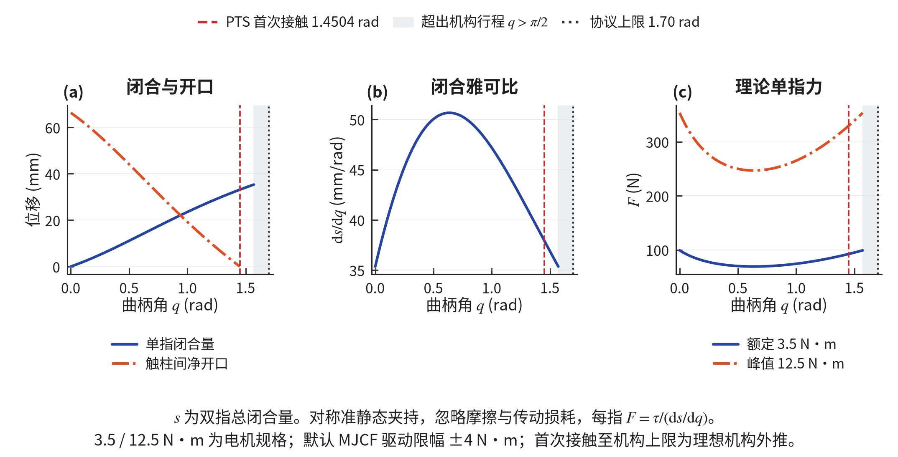
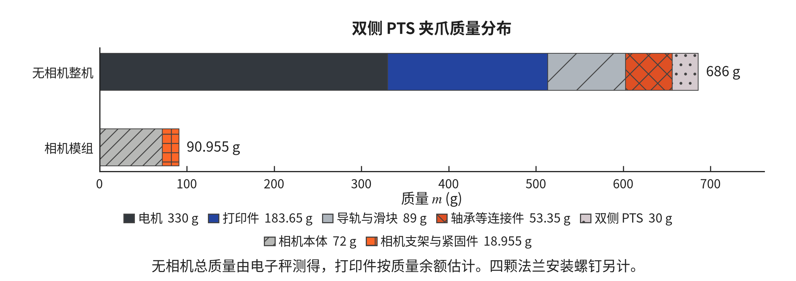

# adaptive_tactile_gripper_description



    [](https://github.com/langxin11/adaptive_tactile_gripper_description/actions)

DM4310 曲柄滑块夹爪的统一描述包，从同一份 Onshape B1 装配生成 MuJoCo 与 ROS 2 模型。

## 特性

- 左右指尖可独立选用九触点 PTS 2.0、平垫或空载，侧置 D435i 可拆卸。
- MuJoCo 描述闭环、回差与触觉碰撞，Xacro 与 SRDF 提供 MoveIt 2 规划接口。
- 真机与 CAD 外观支持按实例切换，共享机构、质量和碰撞参数。

## 30 秒上手

在源码仓库运行以下命令。

**Python**

```bash
uv sync
uv run python -c 'from adaptive_tactile_gripper_description import build_gripper_spec; print(build_gripper_spec(right_sensor="flat_pad", appearance="cad").compile().nbody)'
```

**ROS 2 Jazzy**（在包含本包的工作区根目录）

```bash
source /opt/ros/jazzy/setup.bash
colcon build --packages-select adaptive_tactile_gripper_description --cmake-args -DPython3_EXECUTABLE=/usr/bin/python3
source install/setup.bash
xacro "$(ros2 pkg prefix --share adaptive_tactile_gripper_description)/urdf/gripper_standalone.urdf.xacro" > /tmp/gripper.urdf
```

**CLI**

```bash
uv run atg-description info
uv run atg-description info --right-sensor flat_pad --no-camera
uv run atg-description appearances
uv run atg-description render
```

## 参数速查

下表采用双侧 PTS 2.0，位置均相对基座。

| 参数 | 数值 |
| --- | --- |
| 整机质量 | 无相机 686.00 g，含相机 776.96 g |
| TCP | (0, 0, 145.55) mm |
| 机构行程 | 0 至 π/2 rad，单指 35.355 mm |
| 首次接触 | 1.450404 rad，单指 33.15 mm |
| 彩色光心 | (−20.00, −69.57, 23.80) mm |
| 深度光心 | (−5.00, −69.57, 23.80) mm |

## 模型渲染预览

### 默认配置与机载相机视角



### 模块化可替换传感器与相机开关



### 指尖触觉碰撞球与局部 Site 坐标系


### 闭环曲柄滑块对称闭合序列



---

## 图表

运行 `uv run python tools/render_figures.py`（或 `uv run atg-description render`）可从随包模型和质量账本重新生成 300 dpi PNG 出版图。

| 坐标系与相机视场 | 运动学与理论夹持力 | 整机与相机质量 |
| --- | --- | --- |
|  |  |  |

## 目录结构

| 路径 | 内容 |
| --- | --- |
| `mjcf/`、`urdf/`、`srdf/`、`meshes/` | 底盘与模组、预装配模型、规划组和 STL |
| `config/` | 机构规格、触觉阵列及外观映射 |
| `src/`、`tools/` | Python API、命令行、资产构建与出图脚本 |
| `docs/`、`tests/` | 集成指南、图版与回归测试 |

## 开发与检查

准备 Python 3.12、uv 与 Noto Sans CJK 字体（Pyright 已包含在 `dev` 依赖组中）。完整资产重建还需要原始 Onshape 导出，在仓库根目录准备后运行检查。

```bash
python3 tools/setup_onshape_key.py
source ~/.config/onshape/credentials.env
uvx --from onshape-to-robot==1.8.4 onshape-to-robot tools/onshape_export
uv run atg-description build
bash scripts/check.sh
uvx pre-commit install
```

## 引用与许可

引用模型时请注明 Daliang Xiao、仓库名称、版本号及使用的模组配置。软件采用 MIT 许可。[集成与扩展指南](docs/integration.md) · [版本记录](CHANGELOG.md) · [许可证](LICENSE)
