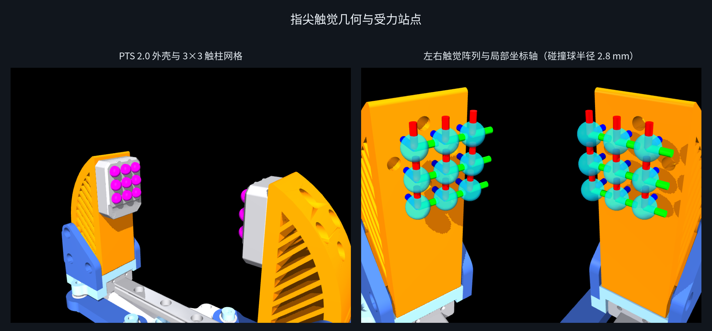

# adaptive_tactile_gripper_description

DM4310 曲柄滑块自适应触觉夹爪（Onshape `B1` 分支）的统一硬件描述仓库。
采用**一仓双打包**（ROS 2 `ament_cmake` + Python `hatchling`）并将**指尖触觉传感器**与**侧挂深度相机**模块化拆分：

- **给 `multipanda_ros2` / MoveIt 2**：提供标准 `urdf/gripper.xacro`、`srdf/gripper.srdf.xacro` 与碰撞包络，支持 `left_sensor`、`right_sensor`、`with_camera` 参数化拼装；
- **给 `tactile_grasp` / MuJoCo**：提供闭环曲柄滑块 `mjcf/gripper_chassis.xml`、可替换传感器模组 `mjcf/sensors/`、相机模组 `mjcf/accessories/` 与 `build_gripper_spec(...)` Python API；
- **单一真值**：机构运动学、行程、TCP 偏置与负载提示集中记录在 [`config/specs.yaml`](config/specs.yaml)。

详细接线与集成说明见 [**下游接入与扩展指南 (`docs/integration.md`)**](docs/integration.md)。

---

## 模型渲染预览

### 默认配置与机载相机视角


### 模块化可替换传感器与相机开关


### 指尖触觉碰撞球与局部 Site 坐标系



### 闭环曲柄滑块对称闭合序列


---

## 目录结构

```text
adaptive_tactile_gripper_description/
├── package.xml & CMakeLists.txt      # ROS 2 Jazzy colcon 安装定义
├── pyproject.toml & src/             # Python 包与 build_gripper_spec() 接口
├── config/
│   ├── specs.yaml                    # 曲柄滑块尺寸、TCP 与 Franka Desk 负载提示
│   └── sensors/{pts_2_0,flat_pad}.yaml
├── docs/
│   ├── integration.md                # multipanda_ros2 / tactile_grasp 接入与扩展指南
│   └── images/                       # MuJoCo 离屏渲染预览图集
├── meshes/                           # 精简后的纯 ASCII 命名 STL 网格
├── mjcf/
│   ├── gripper_chassis.xml           # 闭环底盘（含回差、驱动参数与挂载 frame）
│   ├── gripper.xml                   # 预装配成品（双侧 PTS 2.0 + RealSense D435i）
│   ├── gripper_no_camera.xml         # 预装配无相机版本
│   ├── sensors/{pts_2_0,flat_pad}.xml
│   └── accessories/realsense_d435i.xml
├── urdf/
│   ├── gripper.xacro                 # 顶层可配置宏 adaptive_tactile_gripper
│   ├── gripper_chassis.xacro
│   ├── gripper_standalone.urdf.xacro
│   ├── sensors/{pts_2_0,flat_pad}.xacro
│   └── accessories/realsense_d435i.xacro
├── srdf/gripper.srdf.xacro           # MoveIt 2 规划组与碰撞豁免宏
└── tools/
    ├── setup_onshape_key.py          # Onshape API Key 交互式配置工具
    ├── onshape_export/config.json    # onshape-to-robot 导出配置
    ├── build_description.py          # 从原始导出生成全部模块化资产
    └── render_previews.py            # 生成 docs/images/ 预览图集
```

---

## 快速使用

### 1. 在 MuJoCo / Python 中按需组装

```python
from adaptive_tactile_gripper_description import build_gripper_spec, get_stroke_limits, get_tactile_layout

spec = build_gripper_spec(
    left_sensor="pts_2_0",
    right_sensor="flat_pad",  # 支持左右异构或设为 None
    with_camera=True,
    fixed_base=True,
)
model = spec.compile()
limits = get_stroke_limits("pts_2_0", "flat_pad")
layout = get_tactile_layout("pts_2_0", "flat_pad")
```

### 2. 在 ROS 2 / MoveIt 2 中挂载到 Panda / FR3

在机器人顶层 `.urdf.xacro` 中引入并实例化：

```xml
<xacro:include filename="$(find adaptive_tactile_gripper_description)/urdf/gripper.xacro"/>
<xacro:adaptive_tactile_gripper
    ns="panda_gripper"
    connected_to="panda_link8"
    left_sensor="pts_2_0"
    right_sensor="pts_2_0"
    with_camera="true"
    safety_distance="0.02"/>
```

### 3. 本地安装、测试与从 Onshape 同步最新改版

Python 装配接口要求 `mujoco>=3.10.0,<5`。

```bash
uv sync                                   # 创建独立虚拟环境（安装 MuJoCo 4.0.1 与渲染/测试依赖）
uv run pytest                             # 运行闭环动力学、跨格式和下游接口回归测试

python3 tools/setup_onshape_key.py        # 首次配置 API Key（写入 ~/.config/onshape/credentials.env）
source ~/.config/onshape/credentials.env
uvx --from onshape-to-robot==1.8.4 onshape-to-robot tools/onshape_export
uv run python tools/build_description.py
MUJOCO_GL=egl uv run python tools/render_previews.py
```

---

## 机构行程、碰撞与质量属性

- 电机协议角度范围为 `[0, 1.7] rad`。机构有效曲柄角为 `[0, π/2] rad`，对应单指闭合 35.355 mm。两侧均装 PTS 2.0 或平垫时，名义首次接触发生于 1.450404 rad，单指闭合 33.15 mm。
- MJCF 和 URDF 共享刚体惯量、网格位姿和结构碰撞包络。URDF 保留左右滑块的 mimic 关系，并支持通过同一闭环关节状态同步转子与两根连杆。PTS 2.0 使用九颗半径 2.8 mm 的触觉球。外部避障余量只扩展外侧包络，SRDF 的 32 mm 预设闭合保留 2.3 mm 指间净距。
- 双 PTS、无相机整机使用**实测 686 g 总质量约束**。以打印件均匀填充为假设，通过 STL 体积分估计惯量。电机定转子质量拆分与反射惯量属于建模参数。含相机、支架和相机紧固件的总质量约 777 g。
- D435i 以 Menagerie 模型的主惯量和主轴旋转重建张量。名义相机帧包括 depth、color、infra1、infra2、accel 和 gyro，可通过 `use_nominal_extrinsics` 交由真机驱动发布标定外参。
- 固定基座解析构型的合质量、质心、合惯量及网格 SHA-256 保存在规格文件中。[规格文件](config/specs.yaml)
